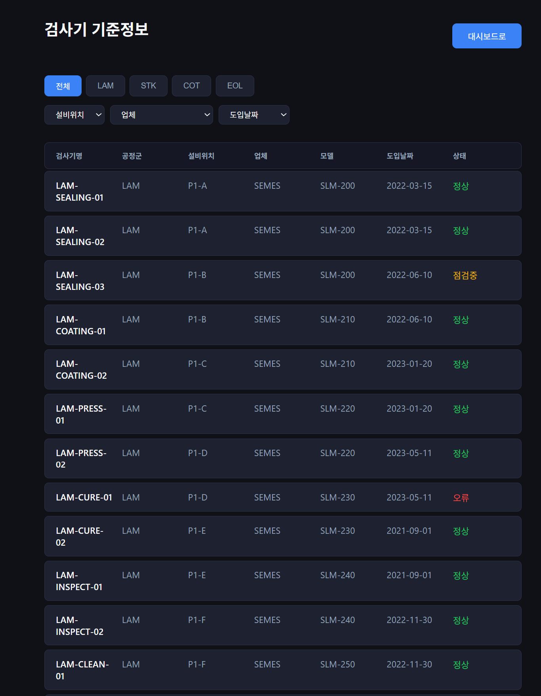
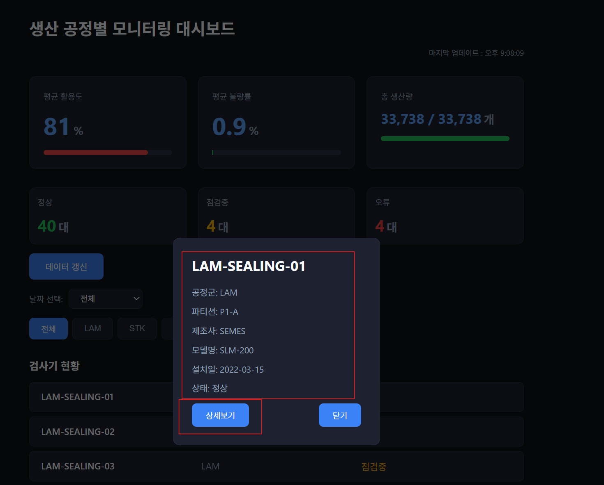
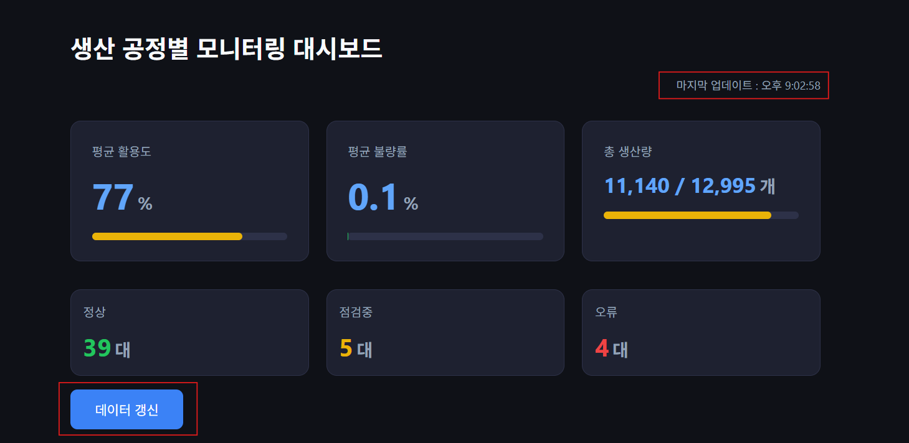
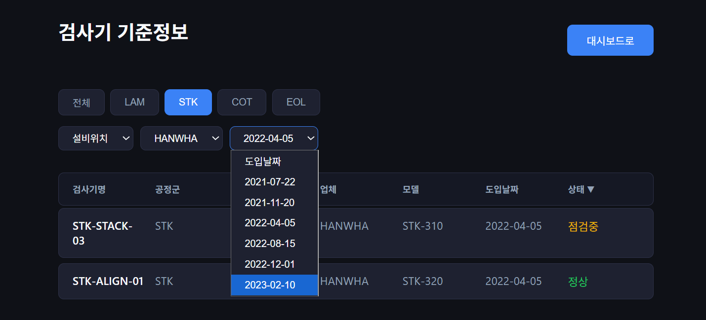
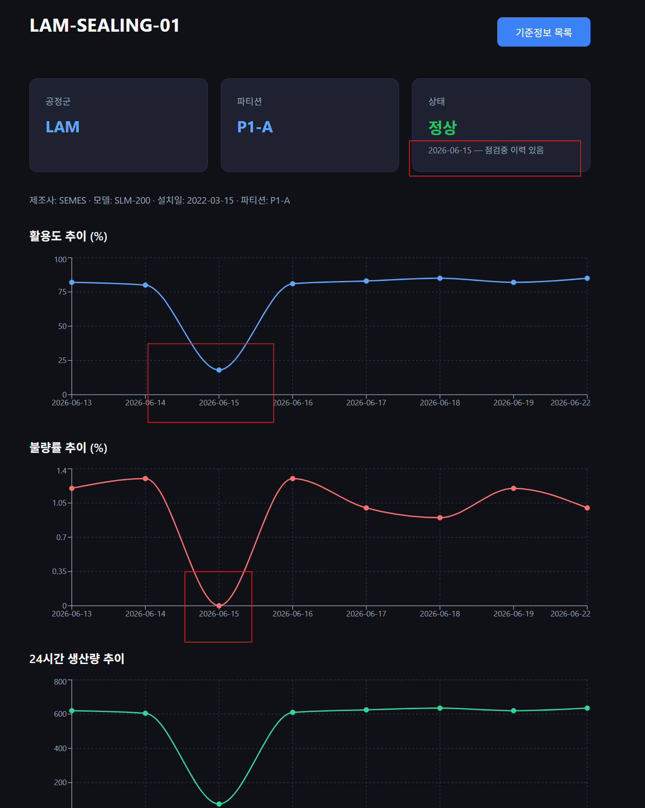

# 생산 공정별 모니터링 대시보드

> React 기반 제조 공정 실시간 모니터링 시스템

LAM · STK · COT · EOL 4개 공정군에 속한 **48대 검사기**의 가동 현황을 날짜별·공정군별로 실시간 모니터링하는 웹 대시보드입니다.

---

## 기술 스택

| 분류 | 기술 |
|---|---|
| 프론트엔드 | React, React Router, JSX, CSS |
| 데이터 시각화 | Recharts |
| API | fetch API, RESTful API (json-server) |
| 빌드 도구 | Vite, concurrently |
| 버전 관리 | Git / GitHub |
| 개발 환경 | VSCode, Claude Code |

---

## 주요 기능

### 메인 대시보드 `/`



- **날짜 필터** — 전체 또는 날짜별 선택. DB에 새 날짜 데이터가 추가되면 드롭다운에 자동 반영
- **공정군 필터** — 전체 / LAM / STK / COT / EOL 버튼으로 즉시 필터링
- **요약 카드** — 평균 활용도, 평균 불량률, 총 생산량(현재/최대) — 필터 연동 실시간 계산
- **상태 요약** — 정상 / 점검중 / 오류 대수 즉시 파악
- **5초 폴링** — 자동 데이터 갱신 + 수동 갱신 버튼

### 검사기 팝업



- 검사기명 클릭 시 기준정보 + 가동 지표 팝업
- 현재 정상이어도 **과거 점검중/오류 이력 날짜** 자동 표시
- 상세보기 버튼으로 검사기 상세 페이지 이동

### 검사기 기준정보 `/machines`





**계층형 필터 시스템**
- 공정군 선택 → 설비위치 옵션 자동 갱신
- 설비위치 선택 → 업체 옵션 자동 갱신
- 업체 선택 → 도입날짜 옵션 자동 갱신
- 상위 필터 변경 시 하위 필터 자동 초기화

**컬럼 정렬**
- 헤더 더블클릭 → 오름차순 → 내림차순 → 정렬 해제
- 상태 정렬: 정상 → 점검중 → 오류 (심각도 기준)

### 검사기 상세 `/machines/:id`



- 7일치 **활용도 · 불량률 · 24시간 생산량** Line Chart
- 점검중/오류 날짜에 수치 변동 반영 (활용도 급감, 생산량 감소)
- 과거 이력 날짜 상태 카드에 표시

---

## 페이지 흐름

```
[/] 메인 대시보드
  └─ 검사기 클릭 → 팝업
       └─ 상세보기 → [/machines/:id] 검사기 상세
                          └─ 기준정보 목록 버튼 → [/machines]

[/machines] 기준정보 목록
  └─ 검사기 클릭 → [/machines/:id] 검사기 상세
```

> 검사기 상세 페이지는 네비게이션 바에서 직접 접근 불가.  
> 특정 검사기 ID 없이는 의미 없는 페이지이므로, 팝업 또는 기준정보 목록을 통해서만 진입하도록 설계.

---

## 데이터 구조

**machines** (48건) — 검사기 기준정보
```json
{
  "id": 1,
  "name": "LAM-SEALING-01",
  "process_group": "LAM",
  "partition": "P1-A",
  "manufacturer": "SEMES",
  "model": "SLM-200",
  "installed_date": "2022-03-15",
  "status": "정상"
}
```

**metrics** (313건) — 날짜별 가동 지표
```json
{
  "id": 1,
  "sequence_no": 202606131001,
  "machine_id": 1,
  "transaction_date": "2026-06-13",
  "status": "정상",
  "utilization": 82,
  "defect_rate": 1.2,
  "production_24h": 620
}
```

> `sequence_no` 규칙: `YYYYMMDD` + 공정코드(`10`=LAM / `20`=STK / `30`=COT / `40`=EOL) + 순번

---

## 실행 방법

```bash
# 의존성 설치
npm install

# json-server + React 개발 서버 동시 실행
npm run start
```

- React 앱: `http://localhost:5173`
- json-server: `http://localhost:3001`

---

## 설계 포인트

1. **계층형 필터** — 공정군 → 설비위치 → 업체 → 도입날짜 순서로 상위 선택 시 하위 옵션 자동 연동
2. **날짜별 검사기 목록 분리** — 점검중/오류 기기는 해당 날짜 데이터가 없을 경우 목록에서 자동 제외
3. **네비게이션 접근 제한** — 검사기 상세 페이지는 특정 ID 없이 의미 없으므로 직접 접근 차단
4. **상태 이력 표시** — 현재 정상이어도 과거 점검중/오류 발생 날짜를 상세 페이지에 자동 표시
5. **실시간 갱신** — 5초 폴링으로 DB 변경 사항 자동 반영
